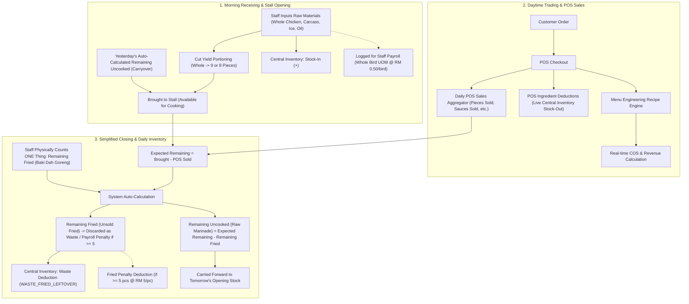

# Unified App Flow & POS-Inventory Integration Plan

## 1. Executive Summary & Core Concept

This document defines the architecture and implementation roadmap to unite **Daily Inventory**, **POS (Point of Sale)**, **Menu Engineering (Recipes & COS)**, and **Central Inventory Management** into a single cohesive operating loop for Ayam Flava Crisp (AFC).



---

## 2. Detailed Understanding of the User Feedback & Problem Analysis

### 2.1 Why the Previous Submission "Wiped Out" Inventory Data
When testing yesterday's submission:
1. Staff entered received raw materials (e.g. 11 Whole Chickens = 99 Pieces, 5 Carcasses, etc.).
2. The legacy Excel sheet had manual tabs for both `Remaining Fried` and `Remaining Uncooked`.
3. Because staff only entered raw deliveries and left the remaining tabs as 0, the legacy formula:
   $$\text{Fried} = \text{Brought} - \text{Remaining Uncooked} = 99 - 0 = 99$$
   $$\text{Sold} = \text{Fried} - \text{Remaining Fried} = 99 - 0 = 99$$
   assumed all 99 pieces were cooked and sold!
4. The system logged:
   - `DAILY_RECEIVED`: $+99$ pieces
   - `DAILY_USAGE`: $-99$ pieces
   - Net stock change: $0$!
5. This is why items like Oil (+4) and Ice (+2) showed up, but Chicken, Carcass, and Sauces appeared to not go through or showed 0 stock.

### 2.2 Why There is No Need for the Manual "Remaining Uncooked" Tab
Now that sales are tracked by the POS:
1. **The POS is the single source of truth for sales:** Every piece of chicken, cup of sauce, and rice set sold is recorded when the cashier punches the order.
2. **Eliminate Redundant Staff Input:** Staff should **not** have to manually calculate or enter `Remaining Uncooked` or `Other Remaining` into an Excel matrix.
3. **The Simple Math:**
   $$\text{Total Remaining Stock at Stall} = \text{Brought to Stall} - \text{POS Sold}$$
4. **Why `Remaining Fried` (Baki Dah Goreng) Must Still Be Manually Counted:**
   - The POS knows what was *sold*, but it *cannot* know if the unsold stall stock is sitting raw in marinade or already fried under the heat lamp.
   - Any chicken that was fried but unsold:
     - Did **not** get sold (so POS never deducted it).
     - **Cannot** carry over to tomorrow (fried chicken spoils overnight; only raw marinated chicken carries over).
     - Must be logged as wastage in Central Inventory (`WASTE_FRIED_LEFTOVER`).
     - Directly impacts **Staff Payroll**: If daily remaining fried chicken reaches $\ge 5$ pieces, the company penalty applies ($\text{RM } 5.00/\text{pc}$ deducted from staff wages).

---

## 3. The New Streamlined Daily Inventory Design

### 3.1 Daily Inventory UI (Clean 3-Section Layout)
Instead of 5 confusing Excel accordions, the Daily Inventory page is simplified to 3 clear operational sections:

```
┌────────────────────────────────────────────────────────────────────────┐
│ 1. MORNING RECEIVING (Barang Mentah)                                   │
│    • Chicken (Whole): [ 11 ] whole (Auto: 99 pcs @ 9 pcs/bird)         │
│    • Carcass: [ 5 ] pcs                                                │
│    • Neck: [ 11 ] pcs (Auto: 2 sets)                                   │
│    • Tube Ice: [ 2 ] bags                                              │
│    • Oil Packet: [ 4 ] kg                                              │
│    ─────────────────────────────────────────────────────────────────   │
│    Today's Brought to Stall:                                           │
│    Chicken: 99 pcs (0 carryover + 99 received)                         │
└────────────────────────────────────────────────────────────────────────┘

┌────────────────────────────────────────────────────────────────────────┐
│ 2. TODAY'S POS SALES (Live from Cashier)                               │
│    • Orders Completed: 12 orders                                       │
│    • Total POS Revenue: RM 248.50                                      │
│    • Chicken Pieces Sold: 80 pcs                                       │
│    • Carcass Sold: 4 pcs                                               │
│    • Rice Sold: 10 sets                                                │
│    • Sauces Sold: 14 units                                             │
└────────────────────────────────────────────────────────────────────────┘

┌────────────────────────────────────────────────────────────────────────┐
│ 3. CLOSING COUNT (Baki Dah Goreng Sahaja)                              │
│    Staff only inputs unsold fried items left in the warmer:           │
│    • Remaining Fried Chicken: [ 4 ] pcs                                │
│    • Remaining Fried Carcass: [ 1 ] pcs                                │
│    • Remaining Fried Neck: [ 0 ] sets                                  │
│    • Remaining Fried Mushroom: [ 0 ] sets                              │
│    ─────────────────────────────────────────────────────────────────   │
│    Auto-Calculated Closing Summary:                                    │
│    • Fried Leftover Penalty: 4 pcs -> RM 0.00 (Safe, <5 pcs)           │
│    • Remaining Uncooked Chicken (Carries to Tomorrow):                 │
│      Brought (99) - Sold (80) - Fried Waste (4) = 15 pieces raw        │
│    • Central Inventory Impact upon Submit:                             │
│      +99 Received (Stock-in)                                           │
│      -4 Fried Leftover Waste                                           │
│      (Sales of 80 pcs already deducted in real-time by POS)            │
└────────────────────────────────────────────────────────────────────────┘
```

---

## 4. Reset & Cleanup Plan for Testing

To allow clean, uncorrupted end-to-end testing of this exact flow:
1. **Clear `daily_inventory` collection:** Delete all test records in `daily_inventory` (e.g. `2026-10-20`).
2. **Clear related transactions in `inventory_transactions`:** Delete all `DAILY_RECEIVED`, `DAILY_USAGE`, `WASTE_FRIED_LEFTOVER`, and `DAILY_VARIANCE` records created from daily inventory tests.
3. **Leave Untouched:**
   - Products & Ingredients in `products` (SKUs, recipes, and prices).
   - POS Orders in `sales_orders` and `payment_transactions`.
   - Menu Engineering recipes.
4. **Reset Base Raw Material Stock:** Re-set stock for `Chicken (Pieces)`, `Carcass`, `Cooking Oil`, and `Tube Ice` so live stock-in from deliveries can be visibly verified.

---

## 5. Execution Steps

### Step 1: Wipe Daily Inventory Test Data & Sync Transactions
- Execute database wipe script targeting `daily_inventory` and `daily_*` reference transactions in `inventory_transactions`.
- Reset test product stocks to baseline.

### Step 2: Simplify Daily Inventory UI & Templates
- In `src/data/dailyInventoryTemplate.js`:
  - Deprecate `remaining_unfried` category from user input.
  - Simplify categories to `raw_materials`, `brought_to_stall`, and `remaining_fried`.
- In `DailyReportPage.jsx` and `StaffDashboardPage.jsx`:
  - Remove the `Remaining Unfried` input tab.
  - Display the automatic carryover formula:
    $$\text{Remaining Uncooked} = \max(0, (\text{Brought} - \text{POS Sold}) - \text{Remaining Fried})$$
  - Show the live preview of tomorrow's carryover stock.

### Step 3: Streamline Inventory Sync (`syncInventoryFromDailyData`)
- When user clicks Submit:
  - Add received raw materials (`DAILY_RECEIVED`).
  - Deduct unsold fried chicken as waste (`WASTE_FRIED_LEFTOVER`).
  - Do **not** deduct standard formula sales usage, because POS already deducted it!
  - Never zero-out inventory.

### Step 4: Verification
- Submit morning raw delivery (e.g. 10 whole chickens = 90 pieces).
- Verify Central Inventory immediately increases by +90 pieces.
- Ring up a POS order of 2 pieces.
- Verify Central Inventory stock becomes 88 pieces.
- At end of day, enter 4 fried leftovers in closing count.
- Submit daily sheet:
  - Uncooked carryover for tomorrow becomes $90 - 2 - 4 = 84$ pieces.
  - Central inventory records $-4$ waste (final balance: 84 pieces).
  - Fried penalty shows RM 0.00 (safe, $< 5$ pcs).
